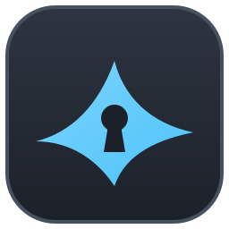

<div align="center">



# authwing

**Two-factor codes that know the window you are in.**

A native authenticator for macOS, Windows and Linux: your TOTP codes in an encrypted vault that syncs between your devices, the right one offered for the app or site you are signing in to, and found by name, by key or by voice.

[](https://github.com/hivepaas/authwing/actions/workflows/ci.yml)
[](https://www.rust-lang.org)
[](https://github.com/zed-industries/zed/tree/main/crates/gpui)
[](LICENSE)

[Status](#-status) • [Getting Started](#-getting-started) • [Configuration](#-configuration) • [Architecture](#-architecture) • [License](#-license)

</div>

---

## 🚧 Status

authwing is in early development and has no release yet. It started from
[shellwing](https://github.com/hivepaas/shellwing)'s code (at `cf92e14`): the
encrypted vault, its sync engine and places, device pairing, the system
keychain, Touch ID and Windows Hello, the languages and the GPUI window come
from there; the SSH client does not.

**Works now**

* **Codes:** TOTP, HOTP and Steam Guard (SHA-1/256/512, 5 to 10 digits), added
  by reading the site's QR code on the screen or in an image, or from an
  `otpauth://` link, a Google Authenticator export or a typed key;
  cards that count down and show the next code at the end of the period;
  copy with a click, Enter or Cmd/Ctrl+1…9, the clipboard cleared after 20 s.
* **Find and file:** type to find by service, account, group or site; groups
  of their own color, favorites and the codes used lately in the sidebar;
  each code's names, group and sites edited after it is added.
* **For the window used last:** the codes for the app you were in come first,
  by the sites saved with them or their name in the window's title.
* **Quick panel:** Option+Space (Ctrl+Alt+Space on Windows and Linux) over any
  app shows the codes for that app or page first; Enter types the code into
  it, Cmd/Ctrl+C copies it.
* **Voice:** hold the quick panel's key and say the name ("GitHub", "mở
  Vietcombank", "Öffne PayPal"): Whisper on the device, in your language,
  the name matched however it was written down; it learns the names it
  mishears.
* **Browser extension** (Chrome, Edge, Brave, Arc, Vivaldi, Firefox; in
  `extension/`): it tells the app the page's exact address, so a code saved
  with that site comes first and is typed into the page when copied; a page
  whose address only looks like a saved site (`github.com.login-verify.io`)
  gets no code and a warning. Not in the stores yet: load it unpacked.
* **Encrypted vault and sync:** through a folder (iCloud Drive, Syncthing,
  Dropbox…) or a Git repository; a new device joins with the recovery key or
  by approving six digits on a device that syncs. Only ciphertext leaves the
  device, the services' names included.
* **Settings:** language, light or dark, text size, the clipboard's time;
  where the vault syncs (folder, Git, WebDAV, S3); the recovery key, a
  passphrase, opening only with it or Touch ID / Windows Hello, Lock;
  linking the browsers.
* **Backup and moving in:** an encrypted backup and restoring it; importing
  Aegis, 2FAS, Ente Auth and Bitwarden exports and lists of `otpauth://`
  links; a plain-text export after a question.
* **Languages:** English and Vietnamese in full; German, Spanish, French,
  Portuguese, Russian, Japanese, Korean and Chinese in part.

**Next:** the extension in the stores, release signing.

---

## 🚀 Getting Started

Build it from source. It needs Rust 1.95+, CMake and each platform's tools
([docs/platforms.md](docs/platforms.md)):

```sh
make run                      # build (debug) and start
make build                    # a release build for this computer, into dist/
cargo run -p authwing         # or by hand
```

To try it without touching your own codes, give it a config directory of its
own: `AUTHWING_CONFIG_DIR=/tmp/aw cargo run -p authwing`. Its vault's key then
has a keychain item of its own too, named by that directory.

---

## ⚙️ Configuration

Settings are in `config.toml` in the config directory (`~/.config/authwing` on
Linux, `~/Library/Application Support/authwing` on macOS, `%APPDATA%\authwing`
on Windows), and apply while the app runs; the gear in the title bar opens it.
Everything is in [docs/configuration.md](docs/configuration.md), and the design
of the vault and its sync in [docs/design](docs/design/README.md).

---

## 🏗️ Architecture

The app is a [GPUI](https://github.com/zed-industries/zed/tree/main/crates/gpui) window over crates with no UI.

| Crate | Role |
| --- | --- |
| `crates/app` | The GPUI window: codes, adding them, the quick panel, Settings, the Sync panel |
| `crates/backup` | authwing's encrypted backup, the plain export, other apps' exports |
| `crates/totp` | One-time codes, `otpauth://` links, Google Authenticator's export |
| `crates/scan` | QR codes read from the screen, an image file or the clipboard |
| `crates/context` | The active app and window, sites against look-alikes, codes ranked for a context |
| `crates/voice` | Matching a spoken name to a code; Whisper, the microphone and the model's download as features |
| `crates/bridge` | The browser extension's protocol, Native Messaging host and installer |
| `crates/vault` | The encrypted vault, and its sync |
| `crates/remote` | Sync places over the network (WebDAV, S3, Git) |
| `crates/config` | `config.toml` and the shortcuts |
| `crates/presence` | Windows Hello and Touch ID |
| `crates/i18n` | The interface's languages |
| `crates/update` | Signed updates (off until authwing has release keys) |
| `crates/spawn` | Starting processes with no signals blocked |

---

## 📜 License

authwing is free software: you can redistribute it and/or modify it under the terms of the GNU General Public License, version 3 or (at your option) any later version. See [LICENSE](LICENSE). Copyright (C) 2026 HivePaaS.

The name and logo are not covered by the GPL: see [TRADEMARKS.md](TRADEMARKS.md). Contributions are welcome under the terms in [CONTRIBUTING.md](CONTRIBUTING.md).

Code adapted from other projects keeps its license and notice: `crates/app/src/input.rs` is adapted from GPUI's `examples/input.rs` (Apache-2.0, Zed Industries). The libraries authwing builds on are all under licenses that allow this (MIT, Apache-2.0, BSD, ISC, Zlib, MPL-2.0 and similar).
